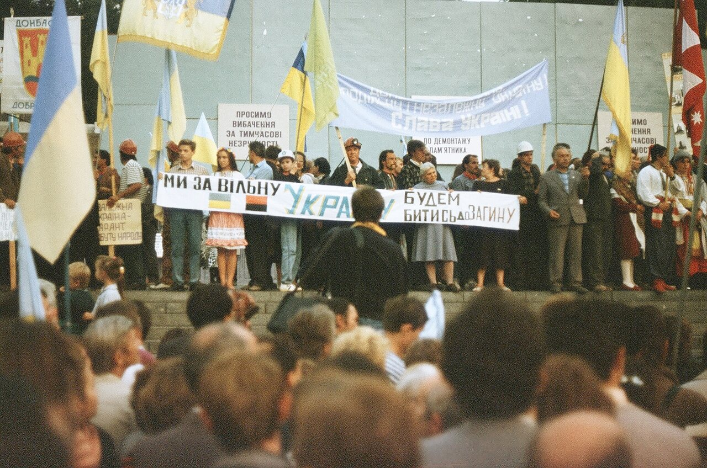
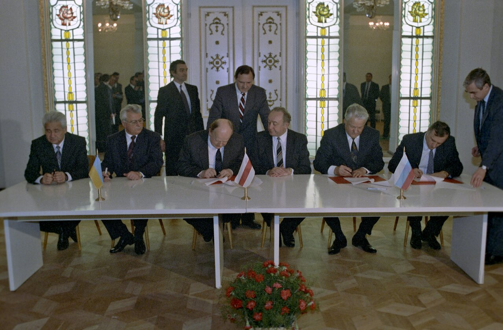
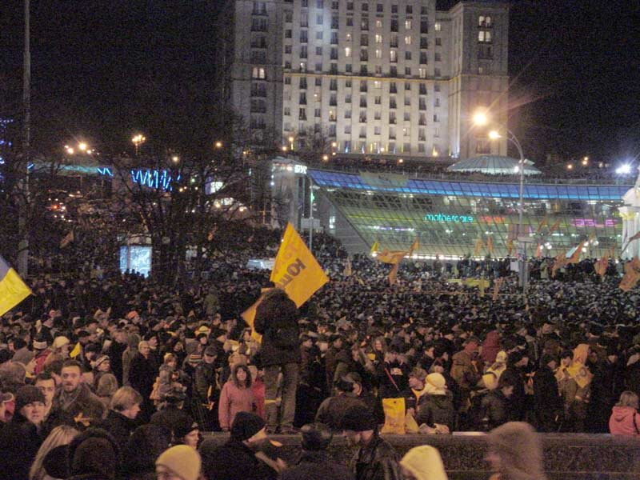
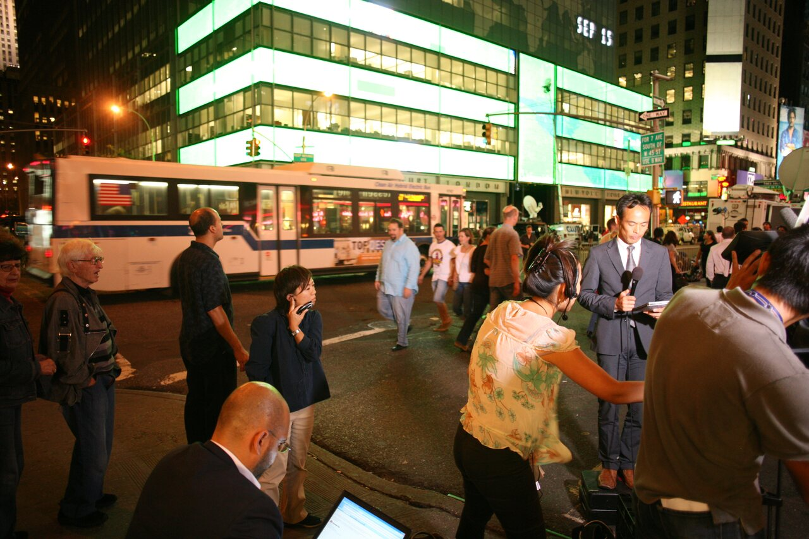
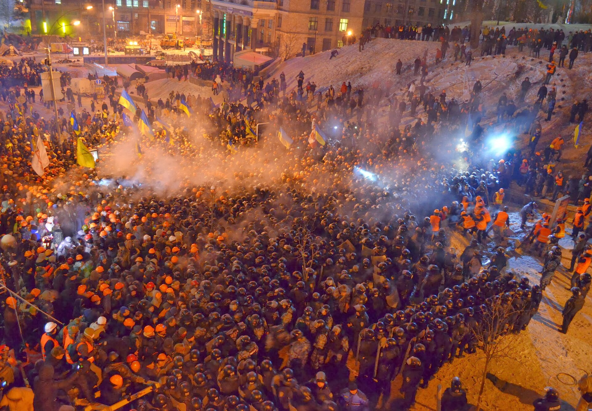
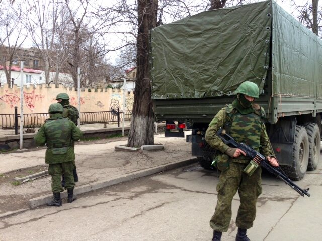
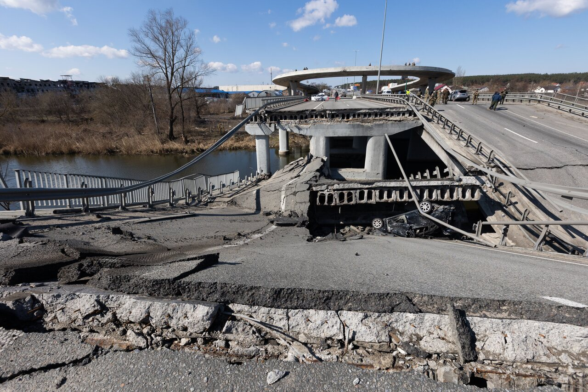

<nav class="history-index" aria-label="Timeline events" hidden></nav>

:::: {.cr-section .history-story}

::: {focus-on="cr-independence" period="Aug 1991"}
## August 1991 · Independence

Ukraine's parliament declared independence on 24 August 1991, following the failed coup in Moscow. Voters approved independence in a nationwide referendum on 1 December. Leonid Kravchuk was elected president on the same day.
:::

::: {#cr-independence}
<figure class="history-photo">

<figcaption>Kyiv independence rally, September 1991. <a href="https://commons.wikimedia.org/wiki/File:%D0%9C%D1%96%D1%82%D0%B8%D0%BD%D0%B3_%D0%BD%D0%B0_%D0%9C%D0%B0%D0%B9%D0%B4%D0%B0%D0%BD%D1%96_%D0%9D%D0%B5%D0%B7%D0%B0%D0%BB%D0%B5%D0%B6%D0%BD%D0%BE%D1%81%D1%82%D1%96%2C_1990-%D1%96_%D1%80%D0%BE%D0%BA%D0%B8.JPG">М. Яковенко and В. Білецький / Wikimedia Commons</a> · Public domain</figcaption>
</figure>
:::

::: {focus-on="cr-belovezha" period="Dec 1991"}
## December 1991 · Belovezha

On 8 December, the leaders of Ukraine, Russia and Belarus signed the Belovezha accords. They declared that the Soviet Union had ceased to exist and established the Commonwealth of Independent States. The Ukrainian parliament ratified the agreement on 10 December.
:::

::: {#cr-belovezha}
<figure class="history-photo">

<figcaption>Signing the accords, 8 December 1991. <a href="https://commons.wikimedia.org/wiki/File:RIAN_archive_848095_Signing_the_Agreement_to_eliminate_the_USSR_and_establish_the_Commonwealth_of_Independent_States.jpg">U. Ivanov / Wikimedia Commons</a> · <a href="https://creativecommons.org/licenses/by-sa/3.0/">CC BY-SA 3.0</a></figcaption>
</figure>
:::

::: {focus-on="cr-orange" period="2004"}
## 2004 · Orange Revolution

Mass protests followed a disputed presidential election between Viktor Yanukovych and Viktor Yushchenko. Ukraine's Supreme Court ordered a repeat of the runoff after finding electoral violations. Yushchenko won the repeated vote in December and became president in January 2005.
:::

::: {#cr-orange}
<figure class="history-photo">

<figcaption>Orange Revolution, 22 November 2004. <a href="https://commons.wikimedia.org/wiki/File:Kiev_Independence_Square_Orange_Revolution_22-11-2004.jpg">Gutsul, original uploader / Wikimedia Commons</a> · <a href="https://creativecommons.org/licenses/by-sa/3.0/">CC BY-SA 3.0</a></figcaption>
</figure>
:::

::: {focus-on="cr-crisis" period="2008"}
## 2008 · Global financial crisis

The global financial crisis hit Ukraine's banks and export-dependent economy. Falling steel demand and constrained external financing intensified the shock. Real GDP contracted sharply in 2009, and Ukraine sought support from the International Monetary Fund.
:::

::: {#cr-crisis}
<figure class="history-photo">

<figcaption>Lehman Brothers, New York, 15 September 2008; global crisis context. <a href="https://commons.wikimedia.org/wiki/File:Lehman_Brothers-NYC-20080915.jpg">Robert Scoble / Wikimedia Commons</a> · <a href="https://creativecommons.org/licenses/by/2.0/">CC BY 2.0</a></figcaption>
</figure>
:::

::: {focus-on="cr-maidan" period="2013"}
## 2013 · Maidan

Protests began in Kyiv in November after President Yanukovych's government suspended preparations for an association agreement with the European Union. Demonstrations grew after police used violence against protesters. The protests continued into 2014, when deadly violence preceded Yanukovych's departure from Kyiv.
:::

::: {#cr-maidan}
<figure class="history-photo">

<figcaption>Maidan, Kyiv, 11 December 2013. <a href="https://commons.wikimedia.org/wiki/File:2013-12-11._%D0%A8%D1%82%D1%83%D1%80%D0%BC_%D0%9C%D0%B0%D0%B9%D0%B4%D0%B0%D0%BD%D0%B0_14.JPG">ВО «Свобода» / Wikimedia Commons</a> · <a href="https://creativecommons.org/licenses/by/3.0/">CC BY 3.0</a></figcaption>
</figure>
:::

::: {focus-on="cr-crimea" period="2014"}
## 2014 · Crimea and the Donbas

Russia occupied and illegally annexed Crimea in 2014. Fighting also broke out in eastern Ukraine between Ukrainian forces and Russia-backed armed groups. The conflict caused deaths and displacement and continued beyond the Minsk agreements.
:::

::: {#cr-crimea}
<figure class="history-photo">

<figcaption>Unmarked soldiers in Simferopol, 2 March 2014. <a href="https://commons.wikimedia.org/wiki/File:VOA-Crimea-unmarked-soldiers.jpg">Elizabeth Arrott / Wikimedia Commons</a> · Public domain</figcaption>
</figure>
:::

::: {focus-on="cr-invasion" period="2022"}
## 2022 · Full-scale invasion

On 24 February 2022, Russia launched a full-scale invasion of Ukraine. The invasion caused widespread casualties, displacement and destruction of infrastructure. Ukraine's economy contracted steeply in 2022 as the war disrupted production and trade.
:::

::: {#cr-invasion}
<figure class="history-photo">

<figcaption>Kyiv outskirts, 4 April 2022. <a href="https://commons.wikimedia.org/wiki/File:Outskirts_of_Kyiv_after_Russian_invasion_of_Ukraine_2.jpg">Oleksandr Ratushniak / Wikimedia Commons</a> · <a href="https://creativecommons.org/licenses/by-sa/4.0/">CC BY-SA 4.0</a></figcaption>
</figure>
:::

::::
